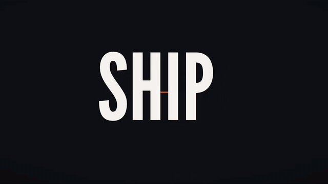
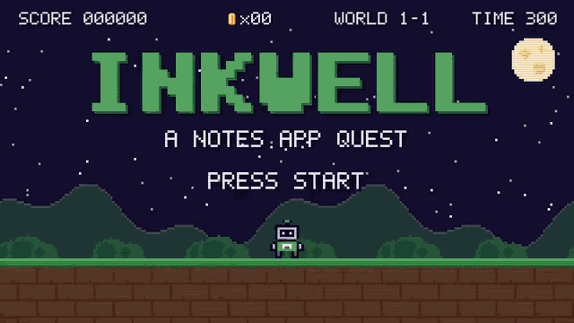
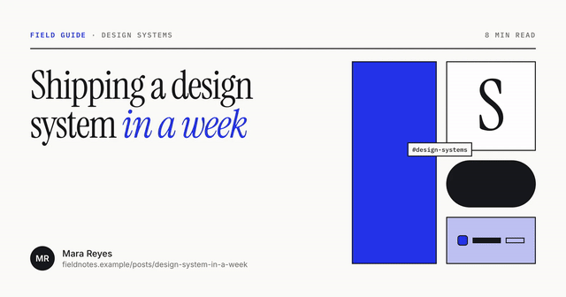
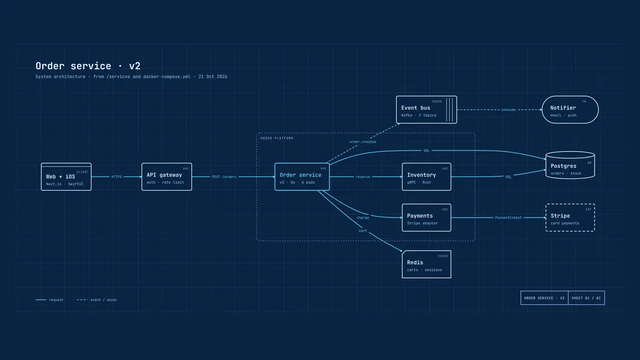
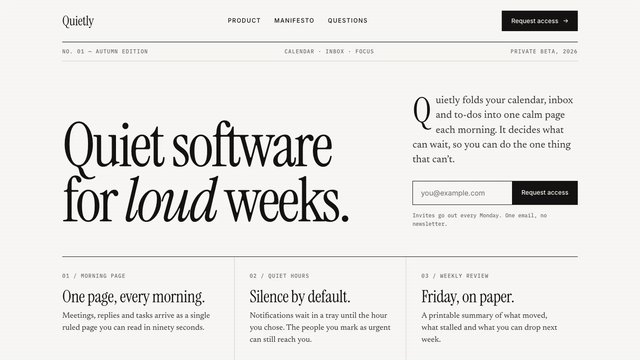
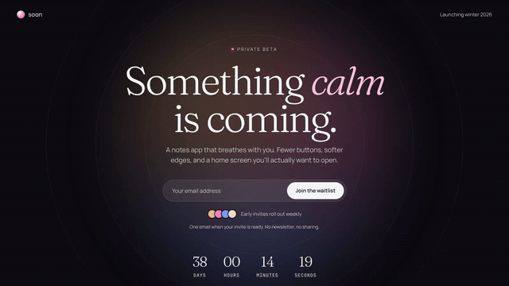

# Lookbk free skills

Seven free agent skills from [Lookbk](https://lookbk.dev/?utm_source=github&utm_medium=repo&utm_campaign=free-skills-readme) that make visual work: a kinetic title video, an 8-bit promo, a slide deck, link-preview images, an architecture diagram and two landing pages. Each one is a folder with a `SKILL.md` that Claude Code, Codex, Cursor, GitHub Copilot, Gemini CLI, OpenCode and other agents can follow, plus the scripts and templates it runs.

Every picture below was rendered by the skill itself. The skills run on your own machine: none of them calls an AI model or asks for an API key.

| | |
| :-: | :-: |
| [](#kinetic-title-drop) | [](#pixel-quest-promo) |
| [](#swiss-grid-deck) | [](#editorial-og-card) |
| [](#blueprint-architecture-diagram) | [](#mono-editorial-landing) |
| [](#waitlist-glow) | |

## Install

### Any agent: the `skills` CLI

```bash
npx skills add SHARPLEE00/lookbk-skills
```

It lists the seven skills, asks which ones and which agents to install them for, and copies them into each agent's skills folder. Add `-g` to install for every project instead of the current one. To skip the questions:

```bash
npx skills add SHARPLEE00/lookbk-skills --skill kinetic-title-drop -a claude-code -g -y
```

The CLI needs Node.js 22.20 or later. It sends anonymous install counts to [skills.sh](https://skills.sh); set `DISABLE_TELEMETRY=1` to turn that off.

### Claude Code: plugin marketplace

Inside a Claude Code session:

```
/plugin marketplace add SHARPLEE00/lookbk-skills
/plugin install lookbk@lookbk-skills
```

`lookbk` installs all seven skills. Their commands carry the plugin name, such as `/lookbk:kinetic-title-drop`, and Claude also uses them when you simply ask for the thing. To install one skill instead, use its name, for example `/plugin install swiss-grid-deck@lookbk-skills`. Install either the bundle or single skills, not both.

From your shell, the same steps are `claude plugin marketplace add SHARPLEE00/lookbk-skills` and `claude plugin install lookbk@lookbk-skills`. On Claude Code 2.1.275 or later, one line does both:

```
/plugin install lookbk --marketplace SHARPLEE00/lookbk-skills
```

### Cursor

```bash
npx skills add SHARPLEE00/lookbk-skills -a cursor -g
```

Or copy skill folders by hand: Cursor reads `.agents/skills/` and `.cursor/skills/` in a project, and `~/.agents/skills/` and `~/.cursor/skills/` for every project. It also reads the Claude Code and Codex skill folders.

### Codex

```bash
npx skills add SHARPLEE00/lookbk-skills -a codex -g
```

Or copy skill folders by hand: Codex reads `.agents/skills/` in your repository and `~/.agents/skills/` for every project.

### By hand

A skill is installed when its folder, with `SKILL.md` directly inside it, sits in a folder your agent reads. Keep the folder name the same as the skill's name.

```bash
git clone https://github.com/SHARPLEE00/lookbk-skills.git
mkdir -p ~/.claude/skills ~/.agents/skills
cp -r lookbk-skills/skills/* ~/.claude/skills/    # Claude Code
cp -r lookbk-skills/skills/* ~/.agents/skills/    # Codex, Cursor, Gemini CLI, Copilot, OpenCode
```

Start a new agent session afterwards so the agent loads the skills. In Claude Code, `/skills` lists what it found.

### Or the Lookbk installer

```bash
curl -fsSL https://lookbk.dev/cli.js | node - add kinetic-title-drop
```

It writes the current version from lookbk.dev to the folders your agents read; run it again to update. The first run prints a sign-in link for a free Lookbk account. Add `--project` to install into the current repository, or `--claude` or `--shared` to write one folder only.

## The skills

Ask your agent in plain words. The agent reads the skill's `SKILL.md`, asks for what it needs (your words, colours, notes or repository), runs the skill's own build and checks, and hands you the files.

### Kinetic Title Drop

[](https://lookbk.dev/skills/kinetic-title-drop?utm_source=github&utm_medium=repo&utm_campaign=free-skills-readme)

A six-second, 1920×1080 kinetic type video (MP4) in three beats, for launch openers, release announcements and social posts. You give it three short lines, a chip, a footer and three colours.

- **Needs:** Node.js 22+, FFmpeg
- **Try:** *Make a 6-second kinetic title drop that says "Ship / it / today." in our brand orange, 1080p, for an X post.*
- [`skills/kinetic-title-drop`](skills/kinetic-title-drop) · [Preview and details on lookbk.dev](https://lookbk.dev/skills/kinetic-title-drop?utm_source=github&utm_medium=repo&utm_campaign=free-skills-readme)

### Pixel Quest Promo

[](https://lookbk.dev/skills/pixel-quest-promo?utm_source=github&utm_medium=repo&utm_campaign=free-skills-readme)

A 20-second 8-bit promo video (MP4, 1080p): a title screen, three platformer stages where a pixel hero collects coins for one feature each, and an ending with your headline and link, all on a 120 BPM grid. It also writes a cue sheet for adding chiptune music.

- **Needs:** Node.js 22+, FFmpeg
- **Try:** *Make a 20-second Pixel Quest promo for our side project launch with the line "LEVEL UP your notes".*
- [`skills/pixel-quest-promo`](skills/pixel-quest-promo) · [Preview and details on lookbk.dev](https://lookbk.dev/skills/pixel-quest-promo?utm_source=github&utm_medium=repo&utm_campaign=free-skills-readme)

### Swiss Grid Deck

[](https://lookbk.dev/skills/swiss-grid-deck?utm_source=github&utm_medium=repo&utm_campaign=free-skills-readme)

A slide deck in the Swiss grid style from your outline or notes: an HTML deck that presents in the browser, a PDF, and an editable PowerPoint file (PPTX) with speaker notes.

- **Needs:** Node.js 18+, Chrome
- **Try:** *Turn notes.md into a 12-slide Swiss Grid deck for our board meeting, with speaker notes, and export PDF and PPTX.*
- [`skills/swiss-grid-deck`](skills/swiss-grid-deck) · [Preview and details on lookbk.dev](https://lookbk.dev/skills/swiss-grid-deck?utm_source=github&utm_medium=repo&utm_campaign=free-skills-readme)

### Editorial OG Card

[](https://lookbk.dev/skills/editorial-og-card?utm_source=github&utm_medium=repo&utm_campaign=free-skills-readme)

1200×630 link-preview images (PNG) for every blog post, doc or newsletter in one editorial look, with the headline set as real text, and the site's meta tags wired up.

- **Needs:** Node.js 18+, Chrome
- **Try:** *Make Editorial OG cards for every post in /content/blog and save them next to each post.*
- [`skills/editorial-og-card`](skills/editorial-og-card) · [Preview and details on lookbk.dev](https://lookbk.dev/skills/editorial-og-card?utm_source=github&utm_medium=repo&utm_campaign=free-skills-readme)

### Blueprint Architecture Diagram

[](https://lookbk.dev/skills/blueprint-architecture?utm_source=github&utm_medium=repo&utm_campaign=free-skills-readme)

A system architecture diagram drawn like an engineering sheet, from a description or by reading your repository, laid out automatically with moving data-flow dots. Outputs an HTML page, an SVG and a PNG.

- **Needs:** Node.js 18+, Chrome for the PNG
- **Try:** *Read this repo and draw a Blueprint architecture diagram of the order service, with data flow animated.*
- [`skills/blueprint-architecture`](skills/blueprint-architecture) · [Preview and details on lookbk.dev](https://lookbk.dev/skills/blueprint-architecture?utm_source=github&utm_medium=repo&utm_campaign=free-skills-readme)

### Mono Editorial Landing

[](https://lookbk.dev/skills/mono-editorial-landing?utm_source=github&utm_medium=repo&utm_campaign=free-skills-readme)

A black-and-white landing page set like a magazine, drafted from your README, as one responsive HTML file with a waitlist form that really signs people up. It checks layout, contrast and accessibility in headless Chrome.

- **Needs:** Node.js 18+, Chrome for the checks
- **Try:** *Build a Mono Editorial landing page for quietly.example from our README, with a waitlist form.*
- [`skills/mono-editorial-landing`](skills/mono-editorial-landing) · [Preview and details on lookbk.dev](https://lookbk.dev/skills/mono-editorial-landing?utm_source=github&utm_medium=repo&utm_campaign=free-skills-readme)

### Waitlist Glow

[](https://lookbk.dev/skills/waitlist-glow?utm_source=github&utm_medium=repo&utm_campaign=free-skills-readme)

A one-screen waitlist or coming-soon page with a breathing gradient glow, one email field that posts to Formspree, Netlify Forms, Buttondown, Mailchimp or your own endpoint, and an optional countdown. The sign-up is tested end to end in Chrome before it goes live.

- **Needs:** Node.js 18+, Chrome, a form service
- **Try:** *Make a Waitlist Glow page for soon.example that posts emails to our Formspree form, with a countdown to December 1.*
- [`skills/waitlist-glow`](skills/waitlist-glow) · [Preview and details on lookbk.dev](https://lookbk.dev/skills/waitlist-glow?utm_source=github&utm_medium=repo&utm_campaign=free-skills-readme)

Each skill's own `SKILL.md` lists exactly what it needs and the steps your agent follows.

## What the skills run and fetch

- **On your machine:** the Node.js scripts in each skill's `scripts/` folder; headless Chrome, Chromium or Edge (already installed) for screenshots, PDFs, PNGs and form tests; FFmpeg for the videos.
- **Downloaded when used:** `kinetic-title-drop` and `pixel-quest-promo` run HyperFrames through `npx --yes hyperframes@0.8.192`, which downloads a headless Chrome on the first render, and load GSAP from a CDN. `swiss-grid-deck` asks you to run `npm i pptxgenjs@4.0.1` before a PowerPoint export. Pages and cards load their fonts from Google Fonts.
- **Sent elsewhere:** none of the skills uploads your files or collects data. The pages that `mono-editorial-landing` and `waitlist-glow` build post sign-ups to the form service you choose, once a visitor signs up on your live page. Their checks try the form against a stand-in service on your own machine.

## More skills

These seven are the free part of a catalog of 58 skills at [lookbk.dev](https://lookbk.dev/skills?utm_source=github&utm_medium=repo&utm_campaign=free-skills-more), as of October 2026. One more free skill, [Roller Diner Hero](https://lookbk.dev/skills/roller-diner-hero?utm_source=github&utm_medium=repo&utm_campaign=free-skills-more), installs from lookbk.dev with a free account. [Lookbk Pro](https://lookbk.dev/pricing?utm_source=github&utm_medium=repo&utm_campaign=free-skills-more) adds the other 50, including:

- **Launch films** made from your site and real screens, cut on a beat grid ([Launch Films](https://lookbk.dev/skills/series/launch-films?utm_source=github&utm_medium=repo&utm_campaign=free-skills-more))
- **Animated website heroes** in WebGL, canvas and scroll, with a paste-in embed and a 1080p video ([Motion Heroes](https://lookbk.dev/skills/series/motion-heroes?utm_source=github&utm_medium=repo&utm_campaign=free-skills-more))
- **Video background heroes** with the headline behind the subject ([Footage Heroes](https://lookbk.dev/skills/series/footage-heroes?utm_source=github&utm_medium=repo&utm_campaign=free-skills-more))
- Pitch, keynote, thesis and workshop decks, quote cards, infographics, product shots, docs sites and more

Every skill on the site shows its rendered result before you install it.

Also from Lookbk: [awesome-ai-motion-videos](https://github.com/SHARPLEE00/awesome-ai-motion-videos), a curated list of motion graphics, launch films, 3D scenes and games that AI coding models made in code, collected from X with credits and, where the creator published it, the exact prompt.

## License

The skills in this repository were written by Lookbk and are released under the [MIT License](LICENSE).

Some skills use third-party software or fonts. Each skill's `NOTICE.md` lists them, and those parts stay under their own licenses:

- `blueprint-architecture` includes **dagre** (MIT), with its license in `vendor/LICENSE-dagre.txt`.
- `kinetic-title-drop` and `pixel-quest-promo` run **HyperFrames** (Apache License 2.0) through `npx` and load **GSAP** from a CDN under the [GSAP Standard License](https://gsap.com/standard-license). Neither is included here.
- `swiss-grid-deck` installs **PptxGenJS** (MIT) when you export a PowerPoint file.
- Fonts (Inter, Instrument Serif, IBM Plex Mono, JetBrains Mono and others, SIL Open Font License 1.1) load from Google Fonts when a skill renders. No font files are included.

The products, people, numbers and addresses in each skill's `examples/` folder are made up.

"Lookbk" and the Lookbk logo (`assets/logo.png`) are not covered by the MIT License. The preview images in `assets/` were rendered by the skills in this repository.
