<!-- 由 scripts/build-readme.mjs 根据 data/skills.json 生成，请改那两个文件，不要直接改这里。 -->
<div align="center">

# Lookbk skills

**能做出看得见的东西的 Agent 技能。** 7 个免费、MIT 许可的技能，Claude Code、Codex、Cursor 等 agent 都能用，在你自己的电脑上渲染视频、幻灯片、图片和网页。

[](https://github.com/SHARPLEE00/lookbk-skills/stargazers) [](LICENSE) [](#the-skills) [](https://lookbk.dev/skills?utm_source=github&utm_medium=badge&utm_campaign=lookbk-skills)

[English](README.md) · 简体中文

<a href="https://lookbk.dev/skills?utm_source=github&utm_medium=hero&utm_campaign=lookbk-skills">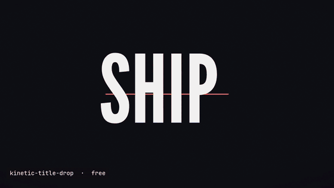</a>

</div>

这一页上的每张图，都是下面对应的技能自己渲染出来的。这些技能不调用任何 AI 模型，也不需要 API key：agent 读 `SKILL.md`，填进你的文字和颜色，跑技能自带的构建和检查，把文件交给你。

如果哪个技能帮你省了一下午，点个 ⭐ 能让更多人找到它。

## 技能列表

<table>
<tr>
<td width="50%" valign="top"><a href="skills/kinetic-title-drop">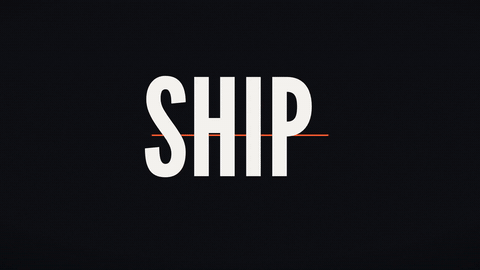</a><br><b><a href="skills/kinetic-title-drop">kinetic-title-drop</a></b><br>6 秒、三拍的动态字标题视频（MP4，1080p），用作开场和发布公告<br><sub>需要: Node.js 22+, FFmpeg · <a href="https://lookbk.dev/skills/kinetic-title-drop?utm_source=github&utm_medium=readme&utm_campaign=lookbk-skills">在 lookbk.dev 上看</a></sub></td>
<td width="50%" valign="top"><a href="skills/pixel-quest-promo">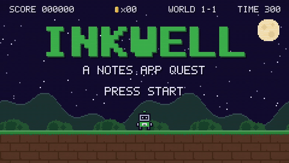</a><br><b><a href="skills/pixel-quest-promo">pixel-quest-promo</a></b><br>20 秒 8-bit 宣传片：像素小人每跑过一关讲一个功能，卡 120 BPM 节拍<br><sub>需要: Node.js 22+, FFmpeg · <a href="https://lookbk.dev/skills/pixel-quest-promo?utm_source=github&utm_medium=readme&utm_campaign=lookbk-skills">在 lookbk.dev 上看</a></sub></td>
</tr>
<tr>
<td width="50%" valign="top"><a href="skills/swiss-grid-deck">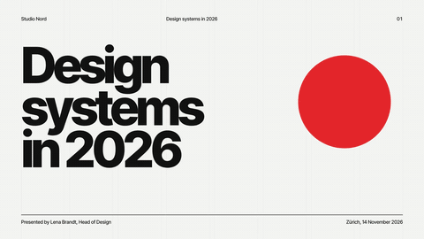</a><br><b><a href="skills/swiss-grid-deck">swiss-grid-deck</a></b><br>把笔记变成瑞士网格风幻灯片：网页版、PDF 和可编辑 PPTX，带演讲备注<br><sub>需要: Node.js 18+, Chrome · <a href="https://lookbk.dev/skills/swiss-grid-deck?utm_source=github&utm_medium=readme&utm_campaign=lookbk-skills">在 lookbk.dev 上看</a></sub></td>
<td width="50%" valign="top"><a href="skills/editorial-og-card">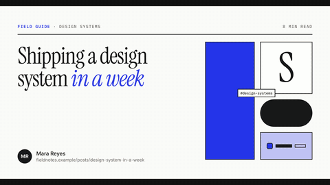</a><br><b><a href="skills/editorial-og-card">editorial-og-card</a></b><br>给每篇博客生成 1200×630 的分享卡片图，并接好 meta 标签<br><sub>需要: Node.js 18+, Chrome · <a href="https://lookbk.dev/skills/editorial-og-card?utm_source=github&utm_medium=readme&utm_campaign=lookbk-skills">在 lookbk.dev 上看</a></sub></td>
</tr>
<tr>
<td width="50%" valign="top"><a href="skills/blueprint-architecture">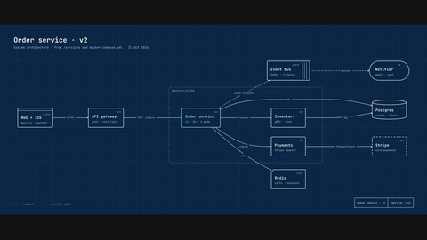</a><br><b><a href="skills/blueprint-architecture">blueprint-architecture</a></b><br>从代码库或一段描述画出蓝图风格的系统架构图，输出 HTML、SVG 和 PNG<br><sub>需要: Node.js 18+, Chrome for the PNG · <a href="https://lookbk.dev/skills/blueprint-architecture?utm_source=github&utm_medium=readme&utm_campaign=lookbk-skills">在 lookbk.dev 上看</a></sub></td>
<td width="50%" valign="top"><a href="skills/mono-editorial-landing">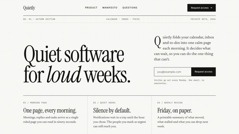</a><br><b><a href="skills/mono-editorial-landing">mono-editorial-landing</a></b><br>根据 README 生成黑白杂志风落地页，带能用的候补名单表单<br><sub>需要: Node.js 18+, Chrome for the checks · <a href="https://lookbk.dev/skills/mono-editorial-landing?utm_source=github&utm_medium=readme&utm_campaign=lookbk-skills">在 lookbk.dev 上看</a></sub></td>
</tr>
<tr>
<td width="50%" valign="top"><a href="skills/waitlist-glow">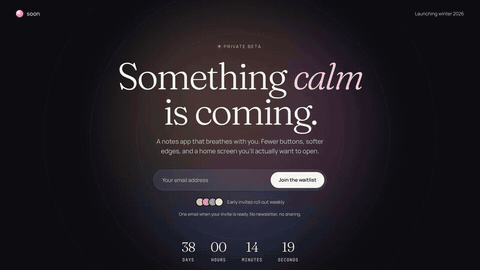</a><br><b><a href="skills/waitlist-glow">waitlist-glow</a></b><br>一屏式候补名单页，带呼吸光效，报名表单端到端测过<br><sub>需要: Node.js 18+, Chrome, a form service · <a href="https://lookbk.dev/skills/waitlist-glow?utm_source=github&utm_medium=readme&utm_campaign=lookbk-skills">在 lookbk.dev 上看</a></sub></td>
<td width="50%"></td>
</tr>
</table>

## 安装

把技能文件夹（`SKILL.md` 直接在里面）放进 agent 会读的目录，就算装好了。

```bash
git clone https://github.com/SHARPLEE00/lookbk-skills.git

cp -r lookbk-skills/skills/* ~/.claude/skills/    # Claude Code
cp -r lookbk-skills/skills/* ~/.agents/skills/    # Codex、Cursor、Gemini CLI、Copilot、OpenCode
```

也可以用 Lookbk 安装器单独装一个，始终是最新版：

```bash
curl -fsSL https://lookbk.dev/cli.js | node - add kinetic-title-drop
```

装完开一个新的 agent 会话，它才会加载技能。在 Claude Code 里用 `/skills` 可以看到装了哪些。[各个 agent 的安装教程 →](https://lookbk.dev/learn?utm_source=github&utm_medium=readme&utm_campaign=lookbk-skills)

## 怎么用

直接用大白话跟 agent 说：

- *做一个 6 秒的动态标题，文字是「Ship / it / today.」，用我们的品牌橙色，1080p，发 X 用。*
- *给我们的 App 做一条像素闯关宣传片：同步、搜索、分享、离线四关。*
- *把 notes.md 做成 12 页瑞士网格风的董事会汇报，带演讲备注，导出 PDF 和 PPTX。*
- *给 /content/blog 里每篇文章做分享卡片，存在文章旁边。*
- *读一下这个仓库，画出订单服务的蓝图架构图，数据流做成动画。*
- *根据我们的 README 做一个黑白杂志风落地页，带候补名单表单。*
- *给我们的内测做一个候补名单页，紫色光效，用 Formspree 收邮箱。*

## 用这些技能做的作品

还没有人投稿。用这些技能做了东西？[提交到展示区](https://github.com/SHARPLEE00/lookbk-skills/issues/new?template=showcase.yml)，选中的会放在这里，并在 lookbk.dev 上署名展示。

## 想要更多？

这 7 个是 [Lookbk 技能库](https://lookbk.dev/skills?utm_source=github&utm_medium=readme&utm_campaign=lookbk-skills) 里免费的部分。Pro 还有：标题藏在主体后面的实拍视频首屏、WebGL 和滚动动效首屏、发布片、演示文稿、金句卡片等等，每个在安装前都能在页面上看到实际渲染效果。

<table>
<tr>
<td width="25%" valign="top"><a href="https://lookbk.dev/skills/neon-motel-hero?utm_source=github&utm_medium=readme-pro&utm_campaign=lookbk-skills">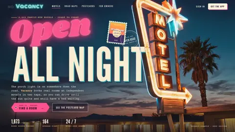</a><br><sub><b>Neon Motel Hero</b><br>视频首屏 Footage Heroes</sub></td>
<td width="25%" valign="top"><a href="https://lookbk.dev/skills/arcade-raccoon-hero?utm_source=github&utm_medium=readme-pro&utm_campaign=lookbk-skills">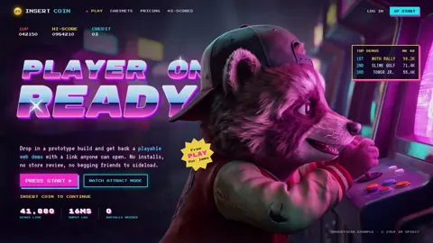</a><br><sub><b>Arcade Raccoon Hero</b><br>视频首屏 Footage Heroes</sub></td>
<td width="25%" valign="top"><a href="https://lookbk.dev/skills/roller-diner-hero?utm_source=github&utm_medium=readme-pro&utm_campaign=lookbk-skills">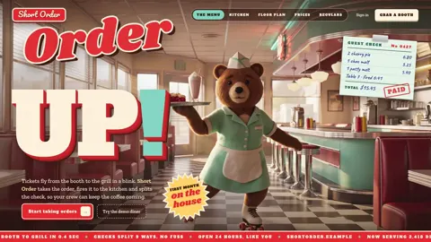</a><br><sub><b>Roller Diner Hero</b><br>视频首屏 Footage Heroes</sub></td>
<td width="25%" valign="top"><a href="https://lookbk.dev/skills/disco-rink-hero?utm_source=github&utm_medium=readme-pro&utm_campaign=lookbk-skills"></a><br><sub><b>Disco Rink Hero</b><br>视频首屏 Footage Heroes</sub></td>
</tr>
<tr>
<td width="25%" valign="top"><a href="https://lookbk.dev/skills/frosted-glass-hero?utm_source=github&utm_medium=readme-pro&utm_campaign=lookbk-skills">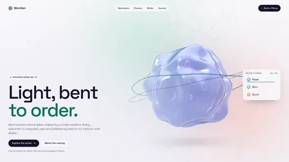</a><br><sub><b>Frosted Glass Hero</b><br>动效首屏 Motion Heroes</sub></td>
<td width="25%" valign="top"><a href="https://lookbk.dev/skills/neon-bloom-hero?utm_source=github&utm_medium=readme-pro&utm_campaign=lookbk-skills">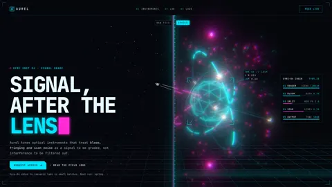</a><br><sub><b>Neon Bloom Hero</b><br>动效首屏 Motion Heroes</sub></td>
<td width="25%" valign="top"><a href="https://lookbk.dev/skills/particle-portrait-hero?utm_source=github&utm_medium=readme-pro&utm_campaign=lookbk-skills">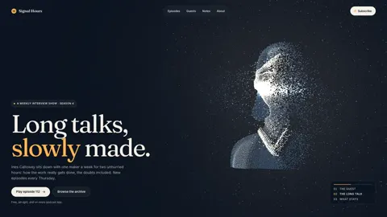</a><br><sub><b>Particle Portrait Hero</b><br>动效首屏 Motion Heroes</sub></td>
<td width="25%" valign="top"><a href="https://lookbk.dev/skills/launch-film-after-hours?utm_source=github&utm_medium=readme-pro&utm_campaign=lookbk-skills">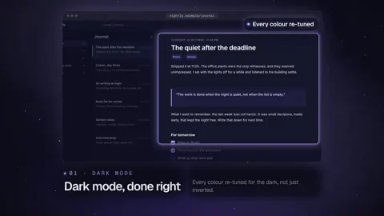</a><br><sub><b>Launch Film: After Hours</b><br>发布片 Launch Films</sub></td>
</tr>
</table>

[浏览全部技能 →](https://lookbk.dev/skills?utm_source=github&utm_medium=readme&utm_campaign=lookbk-skills) · [价格](https://lookbk.dev/pricing?utm_source=github&utm_medium=readme&utm_campaign=lookbk-skills)

## 参与贡献

欢迎提交问题和修复，见 [CONTRIBUTING.md](CONTRIBUTING.md)。想展示你做的作品，请用[投稿表单](https://github.com/SHARPLEE00/lookbk-skills/issues/new?template=showcase.yml)。

## 许可

本仓库的技能由 Lookbk 编写，以 [MIT 许可证](LICENSE)发布。部分技能用到的第三方软件和字体按各自的许可证使用，详见每个技能的 `NOTICE.md` 和[英文版说明](README.md#license)。

`media/` 里的图片由这里的技能和 Lookbk Pro 包渲染；Pro 的图片展示的是付费包，不在 MIT 许可范围内。各技能 `examples/` 里的产品、人物、数字和地址都是虚构的。

"Lookbk" 名称和标志不在 MIT 许可范围内。
