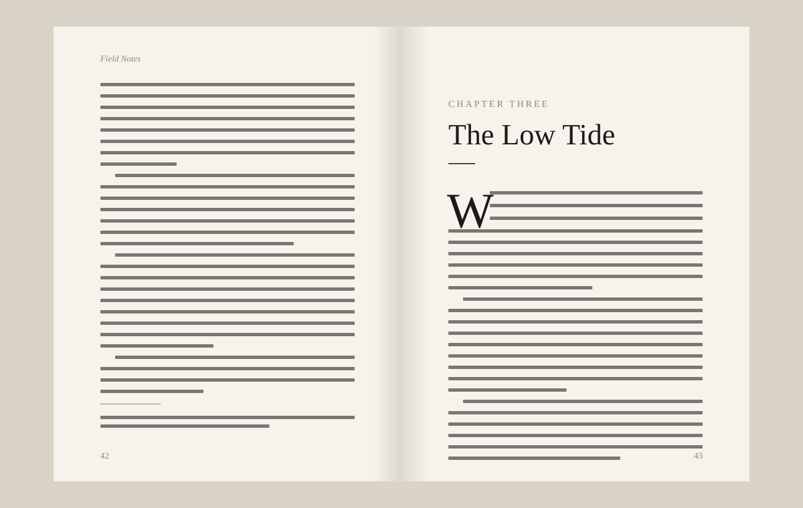

<p align="center"></p>

# Galley

[](https://www.npmjs.com/package/galley-press) [](https://github.com/you/galley/actions)

> Print-ready books from plain Markdown.

Galley turns a folder of Markdown chapters into a typeset PDF and an EPUB, with real page layout: running heads, no widows or orphans, footnotes at the foot of the page and a table of contents with page numbers. It runs on your machine and needs no LaTeX.

## Features

- **Book structure from folders**: parts, chapters, front matter and appendices come from how you name your files.
- **Real typesetting**: whole-paragraph line breaking, hanging punctuation, and widows and orphans kept apart.
- **Footnotes where they belong**: at the foot of the page they're on, numbered per chapter, carried over when they're long.
- **PDF and EPUB from one source**: PDF/X for printers, EPUB 3 for e-readers.

## Install

```sh
npm install -g galley-press
```

Galley needs Node.js 20 or newer. It bundles its own fonts and layout engine.

## Quick start

```sh
galley new field-notes
cd field-notes
galley build    # → dist/field-notes.pdf and .epub
galley watch    # rebuilds the preview on every save
```

## How it works

Galley reads `galley.toml` and your chapters, sets every paragraph with a line breaker that looks at the whole paragraph at once, then fills pages from the top, moving lines between pages until no page starts or ends with a stranded line.

Builds are cached per chapter, so changing one chapter of a 400-page book rebuilds in under a second.



## Themes

Three themes come with Galley, and each is one CSS file you can copy and change.

- `classic`: a novel, set in Newsreader on a 5 × 8 in page
- `essay`: long-form non-fiction with wide margins for notes
- `manual`: technical books with code blocks and numbered figures

## FAQ

### Do I need LaTeX?

No. Galley has its own layout engine, written in TypeScript, and ships its fonts.

### Can I send the PDF to a printer?

Yes. `galley build --pdfx` writes PDF/X-1a with bleed and crop marks, which print-on-demand services accept.

### Does it handle Chinese, Japanese and Korean?

Yes, with line breaking rules for each. Vertical text is not supported yet.

## Contributing

Pull requests are welcome. See [CONTRIBUTING.md](CONTRIBUTING.md).

## License

MIT © Galley contributors
